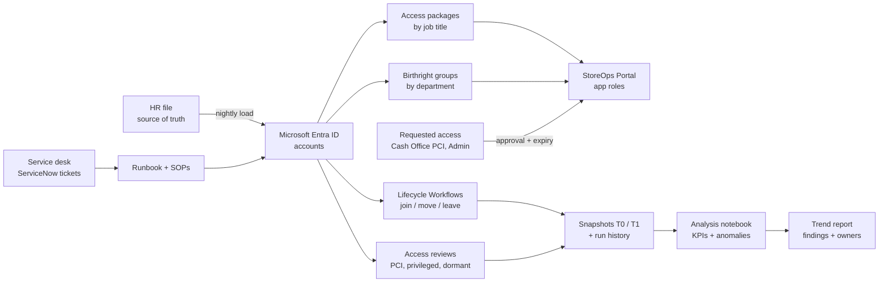
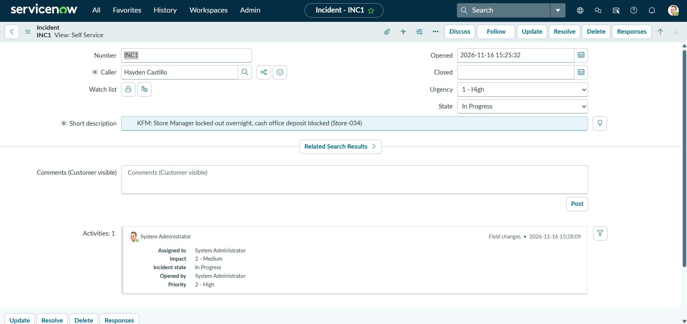
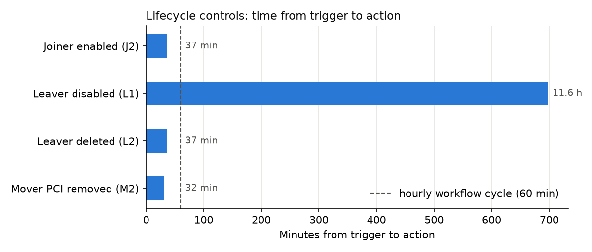
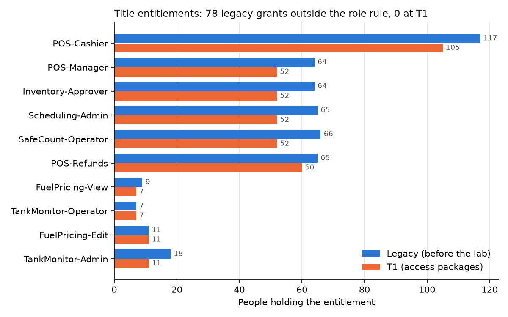
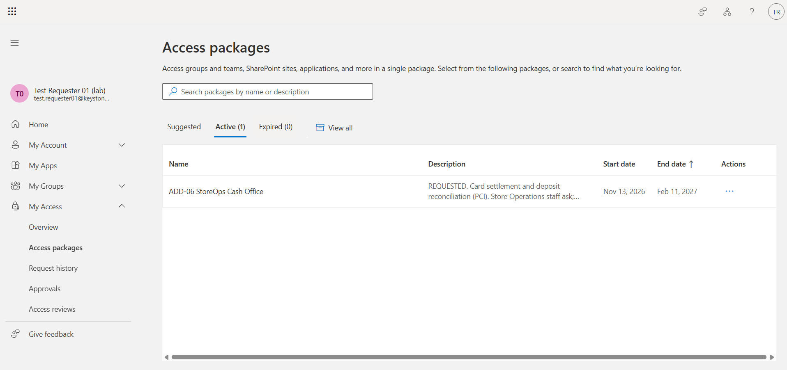

# Keystone Fuel & Market: Identity Lifecycle, Access Governance & Service Desk Lab

**I built the identity side of a fictional 24/7 fuel and convenience retailer (40 stores, about 280 employees) in a Microsoft Entra lab tenant, then supported it like a service desk.** HR data drives account creation, day-one access, job changes and offboarding automatically. Store and fuel access comes from 26 job-based roles instead of one-off grants (78 of 486 legacy grants were outside any role rule → 0 after). Payment card (PCI) and admin access must be requested, approved and expire on their own. I worked 6 IAM incidents end to end in ServiceNow, wrote the procedures and runbook the desk follows, and found trends nobody had flagged: one failed automation went unnoticed for 9 days.

*Built in a personal lab environment with synthetic data. Keystone is fictional and does not represent any real company.*

---

## In 60 seconds

| What a support or IAM team needs | What I did | Proof |
|---|---|---|
| Work call tickets: verify the caller, prioritise, document, resolve | 6 IAM incidents in ServiceNow (lockout at 2 a.m., compromised account, failed leaver, new store opening, break-glass sign-in, reviewer issue), with impact × urgency priority and timed work notes | [incidents](docs/servicenow/m5.3-incidents.md) · [screenshots](evidence/M5/servicenow/) |
| Follow and write scripts, procedures, guides | Leaver procedure (incl. "disable now" for dismissals), app onboarding procedure, triage runbook with 6 playbooks, a one-page "how to request access" guide for store staff | [SOPs](docs/sop/) · [runbook](docs/runbooks/iam-incident-triage.md) · [user guide](docs/training/how-to-request-access-myaccess.md) |
| Notice alerts, notify the right team | Escalation matrix (Security Operations, HR, IT Director); suspicious sign-ins handed to Security before anything is changed; alert designs for failed automations and break-glass use | [runbook §3, §5](docs/runbooks/iam-incident-triage.md) |
| Spot trends that need attention | Analysis notebook over two tenant snapshots: 2 of 11 lifecycle runs had a failed task, one unnoticed for 9 days; 57 people with no manager break approvals; review removals that never happened | [trend report](reports/governance-trend-report.md) · [notebook](notebooks/governance_trends.ipynb) |
| Joiner / mover / leaver | HR-driven accounts and 6 Lifecycle Workflows: joiners enabled 37 min after start; Cash Office (PCI) access removed 32 min after a department change; leavers disabled on the last day and deleted after 7 | [JML process](docs/jml-process.md) |
| Least privilege and access reviews | 26-role catalog, 6 birthright groups, 7 access packages (2 requested with approval, expiry, separation of duties), 3 access reviews incl. PCI and privileged | [role catalog](docs/role-catalog.md) · [packages](docs/access-packages.md) · [review report](reports/2026-11-certification-report.md) |

---

## The scenario

Keystone Fuel & Market runs 40 stores, fuel operations and a corporate office around the clock. Store staff use the POS and a store portal; store managers and some staff handle the **cash office** (card settlement and deposits), which puts that access in **PCI DSS** scope. The problems at the start were typical:

- Access was granted by request and by hand, so 16% of store and fuel access didn't match anyone's job.
- Leavers depended on someone remembering; managers were missing or wrong for 57 people.
- Nobody could say who held payment card access, or why.

## How it fits together



## Service desk work (help desk view)

| Ticket | Priority | What I did | The rule it shows |
|---|---|---|---|
| Store manager locked out at 2 a.m., cash office blocked | P2 | Called back the store landline to verify, checked sign-in logs, issued a one-time pass; refused to let the shift lead use the manager's login | Verify through a trusted channel; never share a login |
| Impossible-travel sign-in on a cashier's account | P1 | Handed to Security Operations, revoked sessions and disabled on their instruction, reset and re-registered MFA by verified call-back | Possible attack → Security owns it |
| Leaver still enabled after the last-day workflow | P1 | Disabled by hand from the leaver procedure, checked for sign-ins in the gap, raised a problem for the missing alert | Contain first; check the person, not the "completed" status |
| Reviewer can't find their review | P3 | Explained the closed stage, spotted the wrong manager on file and routed it to HR | Fix data at the source (HR), never in the directory |
| New store opens tomorrow, 12 people have no accounts | P2 | Declined to hand-make accounts; got HR to enter the hires so automation enabled them at 03:00 | Hand-made accounts become orphans |
| Break-glass (emergency admin) account signed in | P1 | Treated as unauthorised, Security owned it, rotated credentials without disabling the emergency path | Every emergency-account sign-in is an incident |

Response targets: **P1 15 min · P2 30 min · P3 4 h · P4 1 business day**, P1–P2 around the clock ([runbook](docs/runbooks/iam-incident-triage.md)).

## Identity and access governance work (IAM view)

| Module | What I built | Key result |
|---|---|---|
| M0 | Synthetic HR + access data, lab tenant, ServiceNow developer instance | 300 HR records, 1,472 access assignments, 35 entitlements |
| M1 Lifecycle | PowerShell + Microsoft Graph HR load; 6 dynamic birthright groups; Lifecycle Workflows for pre-hire, day one, mover, last day, +7 days | Joiners enabled 37 min after start; a leaver fully offboarded and deleted on schedule |
| M2 Roles | Role mining (Jaccard clustering), 26-role catalog, 5 automatic + 2 requested access packages, separation of duties | 86.9% of access explained by roles; 1,472 approval decisions → 242; 22 SoD conflicts → 0 |
| M3 Reviews | PCI, two-stage privileged and dormant-account reviews; certifier FAQ | 8 of 8 PCI/admin holders decided with reasons; found that review removals never applied (fixed by hand ~17 h later) |
| M4 Trends | T0 → T1 snapshots, KPI and anomaly notebook, trend report with owners and due dates | 78 → 0 grants outside the role rule; 2 of 11 workflow runs had a failed task; 8 findings escalated |
| M5 Operations | Access policy, request workflow, SOPs, user guide, ServiceNow incidents and catalog item, triage runbook | Every policy rule marked Implemented / Partial / Gap with evidence |

## Key findings

- **Two controls said "done" without doing anything.** Access reviews showed *Applied* but removed 0 of 2 denied people; the mover workflow's package removal failed on its only real test. I check the person, not the status, and wrote that rule into the runbook.
- **Failures were silent.** 2 of 11 workflow runs had a failed task; one went unnoticed for 9 days because nothing alerts on it. Designed the alert; until it exists, the daily check in the leaver procedure is the control.
- **Automation is only as fast as HR data.** Workflows acted within the hour (joiner 37 min, PCI removal on a move 32 min), but one leaver kept access 11.6 h because the termination was entered the next morning. Fix agreed in policy: HR enters terminations by the end of the last shift.
- **Bad manager data breaks support.** 57 employees have no manager on file, 27 store managers report to someone below them, 9 stores have no store manager. Approvals, temporary passes and review routing all depend on it, so it's routed to HR as the owner.

## Things that broke (and what I learned)

| What happened | Lesson |
|---|---|
| My HR load script re-sent "account enabled" on every update, which would have re-enabled leavers | Only write the fields you own; a sync must never undo an offboarding |
| I removed the "remove from Teams" task to fix an error, so a leaver stayed in the company-wide Team | Fix the cause, not the symptom; verify the person after every change |
| Access reviews reported success but removed no one | "Applied" is not "removed": verify after every review |
| A failed workflow task sat unnoticed for 9 days | Count failed tasks, not run status; failures need alerts |
| Screenshots contained object IDs my text leak-check couldn't see | Check every image by eye before publishing |
| ServiceNow tickets stayed "In Progress" because I worked them in the Self Service form view | Know your tool's views; check the record after saving |

Full log: [LESSONS.md](LESSONS.md).

## Screenshots

| | |
|---|---|
|  |  |
| ServiceNow: 2 a.m. lockout worked with verification and a one-time pass | Joiner, mover and leaver timing against the hourly workflow cycle |
|  |  |
| 78 legacy grants outside the role rule → 0 | My Access: PCI access requested, approved twice, expires in 90 days |

## Framework mapping

| Framework | Controls | Where |
|---|---|---|
| PCI DSS v4.0.1 | 7.2.1–7.2.4 least privilege and reviews; 8.2.2 shared accounts; 8.2.5 leavers; 8.2.6 inactive accounts; 10.7.2 control failures alerted | [policy](docs/policy/iam-access-control-policy.md) · [trend report](reports/governance-trend-report.md) |
| NIST SP 800-53 | AC-2 account management, AC-5 separation of duties, AC-6 least privilege, IR-4 incident handling, PS-4/PS-5 termination and transfer | [JML](docs/jml-process.md) · [runbook](docs/runbooks/iam-incident-triage.md) |
| CIS Controls v8 | 5.3 dormant accounts, 5.4 admin privileges, 6.1/6.2 granting and revoking, 6.8 role-based access, 17 incident response | [policy](docs/policy/iam-access-control-policy.md) |

## Skills

**Service desk:** Tier 1 ticket handling · ServiceNow (incidents, priority, work notes, assignment groups, service catalog items) · caller identity verification · password reset and account lockout with Temporary Access Pass · following and writing scripts, procedures and job aids · alert triage and escalation · trend spotting from ticket and system data · end-user documentation.

**Identity and access management:** Microsoft Entra ID · Microsoft Graph PowerShell · Lifecycle Workflows (joiner / mover / leaver) · dynamic groups · entitlement management (access packages, approvals, expiry, separation of duties) · access reviews · enterprise app roles · break-glass accounts · role mining (Python, pandas) · PCI DSS, NIST 800-53, CIS Controls.

## Repository map

| Folder | Contents |
|---|---|
| `docs/` | Policy, SOPs, runbook, JML process, role catalog, access packages, review design, user guide, ServiceNow incident scripts, lab environment notes |
| `scripts/` | PowerShell (Microsoft Graph) to load HR data, build groups, packages, workflows and reviews, verify them, export snapshots; Python data generator |
| `notebooks/` | Role mining (M2) and trend analysis (M4) |
| `reports/` | Trend report, access review report, KPI and anomaly CSVs, charts |
| `evidence/` | Sanitized screenshots and exports per module (no tenant or object IDs) |
| `data/t0/` | Synthetic HR and access data (seed 2026) |

## Reproduce the analysis

The notebooks run offline from the committed evidence; no tenant needed.
```powershell
python -m venv .venv
.\.venv\Scripts\Activate.ps1
pip install -r requirements.txt
```
Then open `notebooks/governance_trends.ipynb` in VS Code (Jupyter extension), pick the `.venv` kernel and **Run All**.
The PowerShell scripts need your own Entra lab tenant (Entra ID P1 + Entra ID Governance trial); each has `-DryRun` and `-Verify`. See [lab environment](docs/lab-environment.md) for setup and every deviation from production practice.

## Lab environment

Personal lab tenant on trial licenses (Microsoft 365 Business Premium + Microsoft Entra ID Governance, Oct–Nov 2026) and a ServiceNow Personal Developer Instance. All people and data are synthetic. Some incidents are tabletop scenarios worked in the ticket without changing the tenant; each is labelled. Lab shortcuts (one admin acting as several approvers, admin-assigned test access, a temporary hand-made test user) are documented in [lab-environment.md](docs/lab-environment.md).

## Where this is going

I'm starting in service desk and building toward identity and access management. Next on the list: privileged identity management (just-in-time admin roles), building the two alerts designed here, and connecting ServiceNow requests to Entra so tickets and access stay in step.
