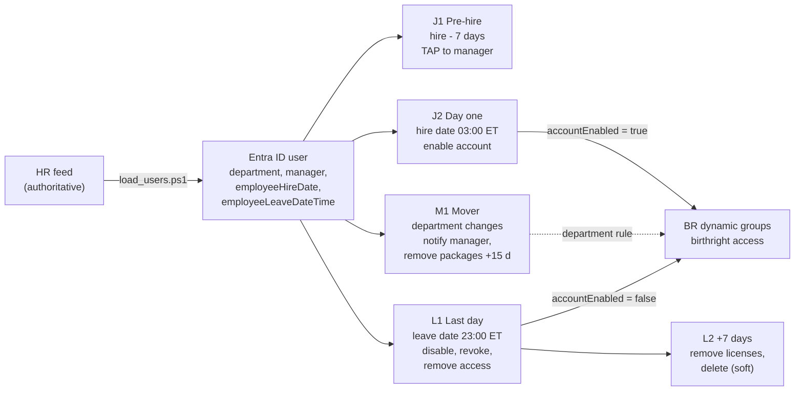

# Joiner / Mover / Leaver (JML) Process — Keystone Fuel & Market

*Module M1.3 · Built in a lab tenant (Microsoft Entra ID Governance trial) · Last updated 2026-10-27*

## 1. Summary

HR is the authoritative source. A nightly HR load (`scripts/load_users.ps1`) **writes data** to Entra ID: attributes, hire date and leave date. **Lifecycle Workflows take the actions:** enable, issue a Temporary Access Pass, notify, disable, revoke and delete. Birthright access is never granted by hand. It comes from the BR dynamic groups (M1.2), which only include enabled accounts.

| Stage | Before (project 1: detect after the fact) | After (this module: prevent) |
|---|---|---|
| Joiner | Account active from creation; credentials handled manually | Created **disabled**; TAP issued 7 days early but valid only from 03:00 on day one; enabled automatically on day one |
| Mover | 24 of 107 movers kept old access (role catalog item 6.3) | Birthright moves with the department attribute; manager notified; requested access removed after a 15-day handover |
| Leaver | 8 leavers still active at review time | Disabled, sessions revoked and access removed **on the last day**; deleted 7 days later |

## 2. Process flow

**Design rules**

1. **The sync writes data; workflows take actions.** `load_users.ps1` sets `accountEnabled` only when it creates an account, so it can never re-enable a leaver (tested: section 4.3).
2. **Future hires are created disabled.** The BR guard (`accountEnabled -eq true`) keeps them out of birthright groups until day one.
3. **HR dates are converted to UTC at a set local time** (America/New_York, DST-aware):
   - hire date at **03:00**, so the account is ready before a 6 a.m. opening shift;
   - leave date at **23:00**, so a closing shift isn't cut off.
4. **Every workflow is scoped** to `companyName eq 'Keystone Fuel & Market'`. Admin and break-glass accounts have no companyName, so they're excluded.
5. **Workflows run on a 1-hour tenant schedule.** A late HR entry is still processed if it's within Microsoft's 3-day catch-up window. Older ones are flagged by the load report (`LeaverMissedWindow`) for a real-time termination on demand.

## 3. Workflow configuration

| ID | Template | Trigger | Tasks |
|---|---|---|---|
| JML-J1 Pre-hire TAP to manager | Onboard pre-hire employee | employeeHireDate, 7 days before | Generate TAP (23 h, multi-use, valid from hire time) and email it to the manager |
| JML-J2 Day one enable | Onboard new hire employee | employeeHireDate, on the day | Enable user account |
| JML-M1 Department change | Employee job profile change | Attribute change: department | Notify manager of move; remove all access package assignments (15-day scheduled removal) |
| JML-L1 Last day offboard | Offboard an employee | employeeLeaveDateTime, on the day | Disable account; revoke refresh tokens; remove access package assignments; remove from all groups; remove from all Teams |
| JML-L2 Plus 7 days delete | Post-offboarding of an employee | employeeLeaveDateTime, 7 days after | Remove all licenses; delete user (soft delete, restorable for 30 days) |

Configuration read back through Microsoft Graph: `evidence/M1.3/workflow_config_after_fix.txt`.

## 4. Test scenarios and results

All HR changes were simulated by editing a copy of the HR feed and running `load_users.ps1 -HrFile <copy>`, never by editing users in Entra. Every run below was **scheduled**, not on demand, unless stated otherwise.

### 4.1 Joiner: Avery Lindqvist (E00301) and Riley Okafor (E00302)

**HR change:** two Store Associates for Store-007, hire date 2026-10-31.
- Avery reports to Store Manager Morgan Haddad.
- Riley was entered **with no manager on purpose**.

| Check | Result |
|---|---|
| Accounts created | 2 created, both `accountEnabled = false`, hire date 2026-10-31 03:00 ET |
| Birthright before day one | BR-01/BR-02 unchanged at 276/158: pre-hires excluded by the guard |
| J1, Avery | **Completed.** TAP created, valid from 10/31 03:00, 23 h; email sent to manager (CC copy redacted in evidence) |
| J1, Riley | **Failed:** "Manager attribute is missing or invalid" |
| J2 (day one) | *Pending: runs 2026-10-31 ~03:00–04:00 ET. Expected: both enabled; BR-01 277, BR-02 158* |

**Finding:** a missing manager in HR means a new hire arrives with **no way to sign in on day one**. HR has 32 more records with no manager and 24 whose manager has been terminated (M1.1). Each one is a future failed onboarding. **Owner: HR (data owner). IAM detects and reports it.**

### 4.2 Mover: Rowan Kowalski (E00004), Store Operations → Fuel Operations

| Check | Result |
|---|---|
| HR load | 2026-10-27 09:01 |
| M1 run | Scheduled run 09:37. **Completed, 2 of 2 tasks.** Change detected within one cycle |
| Birthright | Moved from BR-02 to BR-03 by the department rule; no manual step |
| Manager email | Sent per run history; CC copy not received (lab mailbox limitation) |

### 4.3 Leaver: Logan Nguyen (E00010), Store Associate, Store-033

**HR change:** terminated with last day 2026-10-26, entered the next morning. That's within the catch-up window.

| Check | Result |
|---|---|
| Leave date | 2026-10-26 23:00 ET (2026-10-27 03:00 UTC) |
| L1 run | Scheduled run 10:37. **Completed, 4 of 4 tasks** (after the scope fix in section 5) |
| Account | `accountEnabled = false` |
| Groups | Static "KEY-Store-033 Keyholders" removed by the task. BR-01/BR-02 dropped automatically by the guard. Org-wide M365 group removed after the Teams task was added (section 5). **Final: zero groups** |
| Sync can't undo it | HR load rerun (278 users updated); Logan **stayed disabled**: `evidence/M1.3/logan_after_resync.txt` |
| Group counts | BR-01 275 (Logan), BR-02 156 (Rowan out, Logan out), BR-03 18 (Rowan in); others unchanged. Each difference from t0 explained |
| L2 (+7 days) | *Pending: runs night of 2026-11-01. Expected: deleted, visible under Deleted users* |

## 5. Things that broke (and what they taught)

| Date | What happened | Fix | Lesson |
|---|---|---|---|
| 10-25 | `load_users.ps1` sent `accountEnabled = $true` on all 276 updates. It would have re-enabled every leaver. | Set `accountEnabled` only on create | The sync and the workflows must not fight over the same attribute |
| 10-25 | Changed the schedule to 1 h, but the next run stayed on the old 3 h cycle | None needed; applies from the next cycle | Set the interval **before** enabling schedules |
| 10-27 | L1 and L2 enabled and scheduled, but processed nobody. Graph read-back showed the template's sample scope `department eq 'Marketing'` | Rescoped to companyName | Verify workflow configuration as data; a control that matches zero users isn't a control |
| 10-27 | After offboarding, Logan was still in the org-wide M365 group/Team created with the trial | Re-added "Remove user from all Teams" to L1 and reran it for Logan | "We don't use X" isn't the same as "nobody is in X" |

## 6. Control mapping

| Framework | Control | How this module meets it |
|---|---|---|
| PCI DSS v4.0 | 8.2.5: access for terminated users is immediately revoked | L1 disables the account and removes access on the last day; the resync test proves it stays revoked |
| PCI DSS v4.0 | 7.2.1–7.2.2: access based on job function, least privilege | Birthright by department; mover removes old requested access; pre-hires get nothing until day one |
| NIST SP 800-53 | AC-2 Account management; PS-4 Personnel termination; PS-5 Personnel transfer | J1/J2, L1/L2 and M1 respectively |
| CIS Controls v8 | 6.1 Establish an access granting process; 6.2 Establish an access revoking process | HR-driven joiner and leaver workflows |

## 7. Open items

| # | Item | Owner |
|---|---|---|
| 7.1 | 33 active records with no manager (32 from t0 + Riley) and 24 with a terminated manager. Joiner TAP and mover notification depend on them | HR |
| 7.2 | `create_dynamic_groups.ps1 -Verify` counts every Active HR row; it should exclude future hires and leavers past their leave date | IAM (M1.4) |
| 7.3 | Overnight shifts: a 23:00 leave time cuts off a 22:00–06:00 last shift. Agree with HR that the termination date is the day the last shift **ends** | HR + IAM |
| 7.4 | Access package removal for movers is 15 days. PCI packages (Cash Office, POS admin) should be removed with no grace period. Set this in M2.5 | IAM + Director of Store Operations |

## 8. Evidence (`evidence/M1.3/`)

| File | Shows |
|---|---|
| 01-avery-prehire-disabled.png | Pre-hire created disabled, hire date 03:00 |
| 02-j1-history-users.png / 03-j1-riley-failed-task.png | Joiner TAP run: Avery completed, Riley failed (no manager) |
| 04-avery-tap-pending.png / 05-tap-email-redacted.png | TAP valid from hire time; manager email (code redacted) |
| 06-mover-history.png | Rowan, scheduled mover run, 2 of 2 tasks |
| 08-leaver-history.png | Logan, scheduled leaver run, 4 of 4 tasks |
| logan_after_resync.txt | Sync rerun does not re-enable a leaver |
| workflow_config_after_fix.txt | All five workflows' triggers and scopes, read back through Graph |
| group_counts_*.csv | Birthright group counts against HR before and after the tests |
