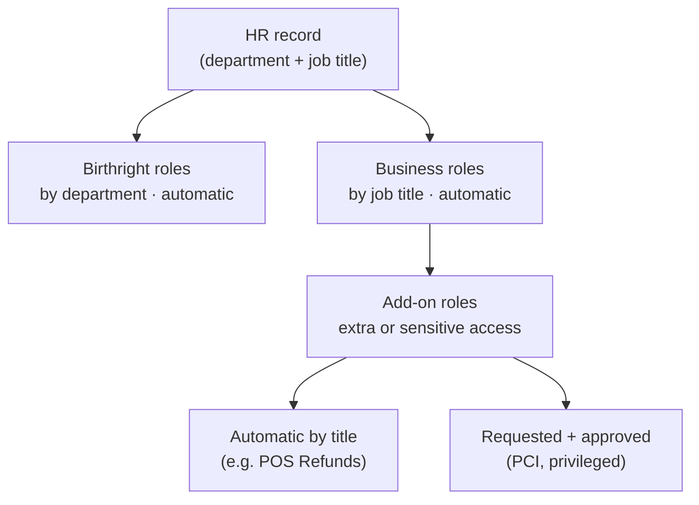
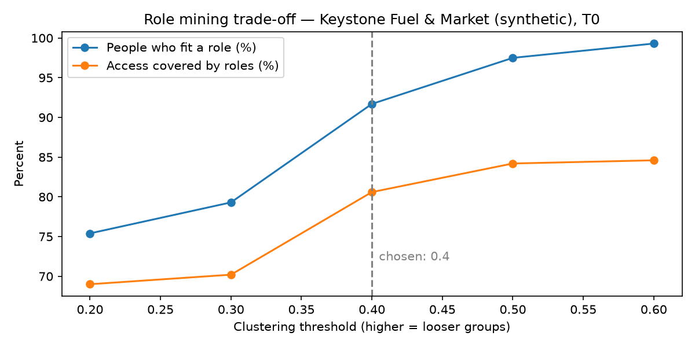

# Role Catalog — Keystone Fuel & Market (fictional)

> **Status:** Draft v0.1 for role-owner review · **Snapshot:** T0 (2026-10-14) · **Prepared by:** IAM Governance (lab)
> All data is synthetic. Built in a personal lab environment.
> Source analysis: [`notebooks/role_mining.ipynb`](../notebooks/role_mining.ipynb) · Machine-readable catalog: [`data/role_catalog_design.csv`](../data/role_catalog_design.csv)

---

## 1. Executive summary

Keystone's 276 active employees hold 1,472 individual access grants, each requested, approved, and reviewed one at a time, and 22 of those employees hold combinations of access that let one person both create and approve the same transaction. To fix this, IAM analyzed who actually holds what and designed a catalog of 26 roles in three layers: department baseline access granted automatically, job-title roles granted automatically from HR data, and add-on roles for sensitive or payment-card access that must be requested and approved. Tested against current access, the catalog explains 86.9% of what people hold today, reduces the access decisions people must make from 1,472 to 242 (83.6% fewer), and makes separation-of-duties conflicts impossible by design (22 → 0). The remaining 64 people hold access no role explains: 24 hold privileged access that will be checked first, 24 are in corporate jobs but kept store systems after changing departments, and the rest will be settled in the next access review. **We are asking each role owner to approve their roles by October 30, 2026 and to decide the open items in section 6.**

| Metric | Before (T0) | With catalog |
|---|---|---|
| Access grants managed individually | 1,472 | 0 (replaced by 911 role assignments) |
| Human decisions (requests + reviews of leftovers) | 1,472 | 242 |
| Share of current access explained by a role | — | 86.9% |
| People with a separation-of-duties conflict | 22 | 0 (catalog cannot create one) |
| People with access needing review | — | 64 |

---

## 2. How the catalog is built

Access is granted in three layers. Each person gets every role they qualify for; nothing is granted outside a role except through a documented exception.

| Layer | Purpose | Assigned by | Count |
|---|---|---|---|
| **Birthright** | Day-one access everyone in a department needs | HR department, automatic | 6 |
| **Business** | Core access for one job title | HR job title, automatic | 15 |
| **Add-on** | Extra or sensitive access layered on a business role | Title (automatic) or request + approval | 5 |

**Method (summary):** a user × entitlement matrix (276 active employees × 35 entitlements) was clustered by Jaccard similarity (average linkage, threshold 0.4) into 13 candidate roles covering 91.7% of people. Candidate roles were then redesigned by hand: layered, SoD-checked, and with sensitive access moved to requested add-ons.

---

## 3. Role catalog

### 3.1 Birthright roles

| Role ID | Role | Who gets it | Eligible people | Entitlements | Owner | Review |
|---|---|---|---|---|---|---|
| BR-01 | All Employees Baseline | Everyone | 276 | APP-Email | IAM Team | Annual |
| BR-02 | Store Operations Baseline | Store Operations | 158 | APP-Timeclock, APP-LearningPortal | Director of Store Operations | Annual |
| BR-03 | Fuel Operations Baseline | Fuel Operations | 17 | APP-Timeclock | Fuel Operations Director | Annual |
| BR-04 | Corporate ERP Read | Finance, Procurement | 36 | APP-ERP-Read | Controller | Annual |
| BR-05 | HR Baseline | Human Resources | 17 | HRIS-Read | HR Director | Annual |
| BR-06 | IT Baseline | Information Technology | 34 | ITSM-Agent | IT Director | Annual |

### 3.2 Business roles

| Role ID | Role | Job title(s) | Eligible people | Entitlements | Owner | Review | Flags |
|---|---|---|---|---|---|---|---|
| BUS-01 | Store Frontline | Store Associate, Shift Lead | 106 | POS-Cashier | Director of Store Operations | Semiannual | |
| BUS-02 | Store Manager | Store Manager | 52 | POS-Manager, Inventory-Approver, Scheduling-Admin, SafeCount-Operator | Director of Store Operations | Semiannual | PCI |
| BUS-03 | Fuel Technician | Fuel Technician | 6 | FuelPricing-View, TankMonitor-Operator | Fuel Operations Director | Semiannual | |
| BUS-04 | Fuel Operations Manager | Fuel Operations Manager | 11 | FuelPricing-Edit, TankMonitor-Admin | Fuel Operations Director | Quarterly | Privileged |
| BUS-05 | Accounts Payable | AP Specialist | 5 | ERP-VendorPayment-Create | Controller | Semiannual | |
| BUS-06 | Accounts Receivable | AR Specialist | 8 | ERP-Receivables-Edit | Controller | Semiannual | |
| BUS-07 | Accounting Manager | Accounting Manager | 7 | ERP-VendorPayment-Approve, ERP-GL-Post | Controller | Quarterly | Privileged |
| BUS-08 | Buyer | Buyer | 9 | ERP-PO-Create, ERP-Vendor-Create | Procurement Director | Semiannual | |
| BUS-09 | Procurement Manager | Procurement Manager | 7 | ERP-PO-Approve, ERP-Vendor-Create | Procurement Director | Semiannual | |
| BUS-10 | HR Records | HR Generalist | 5 | HRIS-Employee-Edit | HR Director | Semiannual | |
| BUS-11 | Payroll Approver | HR Manager | 12 | HRIS-Payroll-Approve | HR Director | Quarterly | |
| BUS-12 | Service Desk | Service Desk Analyst | 11 | Directory-PasswordReset | IT Director | Semiannual | |
| BUS-13 | IAM Analyst | IAM Analyst | 11 | Directory-Read | IAM Manager | Semiannual | |
| BUS-14 | Payments Analyst | Payments Analyst | 2 | Payments-Gateway-Read, Chargeback-Edit | Payments Director | Quarterly | PCI |
| BUS-15 | Payments Manager | Payments Manager | 12 | Chargeback-Approve | Payments Director | Quarterly | PCI |

### 3.3 Add-on roles

| Role ID | Role | Eligible title(s) | Eligible people | Entitlements | Assignment | Approval | Review | Flags |
|---|---|---|---|---|---|---|---|---|
| ADD-01 | POS Refunds | Shift Lead | 60 | POS-Refunds | Automatic | None | Quarterly | |
| ADD-02 | PCI Environment Access | Payments Analyst, Payments Manager | 14 | PCI-CDE-Jumpbox | **Requested** | Manager + PCI Owner | Quarterly | PCI |
| ADD-03 | Payments Gateway Admin | Payments Manager | 12 | Payments-Gateway-Admin | **Requested** | Manager + PCI Owner | Quarterly | PCI, Privileged |
| ADD-04 | Server & Directory Admin | Systems Administrator | 12 | Directory-Admin, Server-Admin | **Requested** | Manager + IT Director | Quarterly | Privileged |
| ADD-05 | Access Review Administrator | IAM Analyst | 11 | IGA-Reviewer-Admin | **Requested** | IAM Manager | Quarterly | Privileged |

**Incompatible roles (must never be held together):** ADD-04 Server & Directory Admin ↔ ADD-05 Access Review Administrator (an admin must not control the reviews of their own access). BUS-10 HR Records ↔ BUS-11 Payroll Approver.

---

## 4. Design decisions

Each decision below changed what the role mining suggested. Write each "Why" in your own words, using Keystone's numbers.

### D1. Split the mined HR Manager role (CR-03)
- **Mining found:** candidate role CR-03 (12 people, 83% HR Managers) contained both `HRIS-Employee-Edit` and `HRIS-Payroll-Approve`, a separation-of-duties conflict.
- **Decision:** split into BUS-10 HR Records (HR Generalists) and BUS-11 Payroll Approver (HR Managers), marked incompatible.
- **Why:** One person who can both edit employee records and approve payroll could create a fake employee, or raise someone's pay, and then approve the paycheck with no one else involved. Splitting the access means every payroll change needs two different people. All 12 HR Managers hold both today; that is tracked as open item 2, where the HR Director either removes record-editing from HR Managers or signs a documented exception with an independent monthly payroll-change review.

### D2. Layer Store Frontline + POS Refunds instead of separate roles
- **Mining found:** candidate role CR-01 (103 people) merged Store Associates and Shift Leads (Jaccard similarity 0.8); the only difference was `POS-Refunds`.
- **Decision:** one business role (BUS-01) for both titles, plus add-on ADD-01 for Shift Leads only.
- **Why:** One merged role would give all 46 Store Associates the ability to issue refunds, which they do not need. Two full roles would repeat the same frontline access in both and start role explosion, where every small variation becomes another role to maintain and review. Layering keeps one shared base role for 106 people and adds refunds only for the 60 Shift Leads, so the next variation is a small add-on instead of a new role.

### D3. Sensitive access is requested, even when everyone in a group holds it
- **Mining found:** 100% of Payments / PCI staff hold `PCI-CDE-Jumpbox`; 100% of Systems Administrators hold `Server-Admin`.
- **Decision:** ADD-02 through ADD-05 are requested add-ons with named approvers and quarterly review.
- **Why:** The fact that everyone in a group holds this access today shows it was granted, not that each person needs it. PCI DSS 7.2 expects access to the cardholder data environment to be approved per person, based on need, with a record of that approval, and privileged access carries the same risk if misused. A job title alone is not proof of need, because HR data can be wrong: 27 people in this dataset changed departments and kept their old access.

### D4. Clustering threshold 0.4
- **Decision:** cut the similarity tree at distance 0.4 (members ≥60% alike on average).
- **Why:** At 0.4 the share of people who fit a role jumps from 79.3% to 91.7%, while looser settings add only small gains after that (the bend in the chart below). At 0.5, Buyers and Procurement Managers merged into one group, erasing the line between creating and approving purchase orders, and Payments Managers were absorbed into the cashier group, which hid their unusual access.

---

## 5. Coverage results (T0)

| Access grants by how the catalog explains them | Grants | Share |
|---|---|---|
| Birthright roles | 696 | 47.3% |
| Business roles | 462 | 31.4% |
| Add-on roles | 121 | 8.2% |
| **Not explained — review** | **193** | **13.1%** |
| **Total** | **1,472** | **100%** |

**Validation:** the 64-person review list was checked against the synthetic dataset's seeded answer key. It flagged all active people with planted excess access (22), mover drift (27) and SoD violations (22), with no false positives. Because the dataset's normal access follows the same title rules the catalog encodes, real-world precision would be lower; legitimate exceptions (temporary coverage, project access) would appear on the review list.

---

## 6. Open items for role owners

The 64 people on the [review list](../reports/m2-catalog-review-list-t0.csv) hold 193 grants that no role explains. They are grouped below by risk, highest first, with one escalation and one approval request added. A person can appear in more than one item.

| # | Item | People / grants | Decision owner | Action | Due |
|---|---|---|---|---|---|
| 6.1 | `Server-Admin` held by a Store Manager | 1 / 1 | IT Director + SecOps | Escalate, verify, remove | **Immediate** (by 2026-10-17) |
| 6.2 | Privileged access not explained by any role | 24 / 29 | Each employee's manager + IT Director | Justify or remove | 2026-10-23 |
| 6.3 | Store tools held outside Store Operations (mover drift) | 24 / 107 | IAM Team, confirmed by managers | Remove; fix the mover process | 2026-10-30 |
| 6.4 | HR Managers holding both HR Records and Payroll Approve | 12 / 12 | HR Director | Remove one side or sign an exception | 2026-11-13 |
| 6.5 | Other access not explained by any role | 28 / 45 | Each employee's manager | Certify in the access review | 2026-11-15 |
| 6.6 | Approve this catalog | 26 roles | All role owners | Approve or return with changes | 2026-10-30 |
| | **Total on review list** | **64 / 193** | | | |

### 6.1 Server-Admin held by a Store Manager — escalate now
- **What we found:** one Store Manager (`jordan.lindqvist`) holds `Server-Admin`, plus `POS-Cashier`. No role for a Store Manager includes server administration.
- **Why it matters:** `Server-Admin` controls servers, which at a retailer can include systems in the payment card environment. A store manager's account is a common phishing target, so this one account turns a phishing email into server control.
- **Recommended action:**
  1. IAM opens a security ticket and notifies the IT Director and SecOps the same day.
  2. Check for an approved request or ticket that explains the access (for example, temporary IT coverage).
  3. Review sign-in and activity logs for any use of the access.
  4. If there is no approval, remove `Server-Admin`; if there was unexplained use, SecOps treats it as an incident.
  5. `POS-Cashier` is low risk and goes through item 6.5.
- **Decision needed from:** IT Director (keep or remove); SecOps (incident or not).
- **Due:** immediate. Privileged access on the wrong account is not left waiting for a scheduled review.
- **Controls:** NIST AC-6(5), PCI DSS 7.2.2.

### 6.2 Privileged access not explained by any role — 24 people, 29 grants
- **What we found:** 24 people hold privileged access that no role gives them: `ERP-GL-Post` (8), `TankMonitor-Admin` (7), `Payments-Gateway-Admin` (4), `Server-Admin` (4, including item 6.1), `IGA-Reviewer-Admin` (3), `Directory-Admin` (3). Fifteen of them work in stores (6 Shift Leads, 5 Store Associates, 4 Store Managers).
- **Why it matters:** privileged access lets someone change financial records, payment systems, fuel equipment settings, or other people's access. Each unexplained grant is a high-impact target if the account is compromised. `Payments-Gateway-Admin` is also PCI-scoped.
- **Recommended action:**
  1. Send each employee's manager a list of their people's privileged grants.
  2. Manager responds within 5 business days: *needed (with business reason)* or *not needed*.
  3. "Not needed" or no response → IAM removes the access.
  4. "Needed" → the person requests the matching add-on role (for example ADD-03, ADD-04) so the access gets a named approver and quarterly review; anything with no matching role becomes a documented exception.
- **Decision needed from:** each employee's manager, with the IT Director approving any exception.
- **Due:** 2026-10-23 (one week). High impact, but not single-account urgent like 6.1.
- **Controls:** NIST AC-6(5), PCI DSS 7.2.2, CIS 5.4.

### 6.3 Store tools held outside Store Operations — 24 people, 107 grants
- **What we found:** 24 people in corporate departments still hold store systems: `APP-LearningPortal` (22), `APP-Timeclock` (20), `SafeCount-Operator` (14), `Inventory-Approver` (12), `POS-Manager` (12), `Scheduling-Admin` (12), `POS-Cashier` (10), `POS-Refunds` (5). They sit in Human Resources (25 grants), Finance (22), Payments / PCI (19), Procurement (18), IT (13) and Fuel Operations (10).
- **Why it matters:** this is the pattern left when people transfer out of stores and their old access is never removed (mover drift). It is the largest group on the list. `POS-Manager` is PCI-scoped, and `SafeCount-Operator` gives access to cash counts at a store the person no longer works in.
- **Recommended action:**
  1. IAM sends each manager the list with a default of **remove**; managers have 5 business days to object.
  2. IAM removes everything not objected to.
  3. **Fix the cause:** a mover lifecycle workflow removes old department birthright access whenever HR changes someone's department (built in M1.3).
  4. Re-measure at snapshot T1 (M4) to confirm the count drops and stays down.
- **Decision needed from:** IAM Team (owner of the clean-up); each manager confirms.
- **Due:** 2026-10-30. Mostly low-impact access with a clear cause, so remove quickly, but after the privileged items.
- **Controls:** NIST AC-2, PCI DSS 7.2.4, CIS 6.2.

### 6.4 HR Managers holding both HR Records and Payroll Approve — 12 people
- **What we found:** all 12 HR Managers hold `HRIS-Employee-Edit` in addition to their Payroll Approver role, which recreates the conflict removed in design decision D1.
- **Why it matters:** one person can change an employee record (pay rate, bank details, a new hire) and approve the payroll that pays it.
- **Recommended action** (HR Director chooses one):
  1. **Preferred:** remove `HRIS-Employee-Edit` from HR Managers; HR Generalists keep record editing.
  2. **If the team is too small to separate duties:** keep both, and sign a documented exception with a compensating control, such as an independent monthly review of all payroll changes by Finance, renewed every 6 months.
- **Decision needed from:** HR Director, with Internal Audit consulted on any exception.
- **Due:** 2026-11-13 (about 30 days). Changing HR duties needs the director's decision and some planning, but a known fraud risk should not wait for the next annual cycle.
- **Controls:** NIST AC-5, ISO 27001 A.5.3.

### 6.5 Other access not explained by any role — 28 people, 45 grants
- **What we found:** the remaining unexplained grants, for example `ERP-PO-Approve` (5), `ERP-VendorPayment-Create` (4), `APP-ERP-Read` (4), `HRIS-Employee-Edit` (4), `HRIS-Payroll-Approve` (4) and `ERP-PO-Create` (3), held by people whose role does not include them.
- **Why it matters:** individually lower impact, but several are financial approval rights, which matter for separation of duties.
- **Recommended action:**
  1. Include every grant in the M3 access review campaign, reviewed by each employee's manager.
  2. Keep only with a written business reason; otherwise the review removes it automatically.
  3. Access kept for 3 or more people with the same title is a signal the catalog needs an update; send it back to the role owner.
- **Decision needed from:** each employee's manager (reviewer); role owners for catalog updates.
- **Due:** 2026-11-15, the end of the M3 access review.
- **Controls:** PCI DSS 7.2.4, NIST AC-2(j).

### 6.6 Approve this catalog — all role owners
- **What we need:** each role owner (section 3 "Owner" column) approves their roles or returns them with changes.
- **Why it matters:** roles become automatic access for every future hire, so the business, not IAM, must agree each one is right.
- **Recommended action:**
  1. 30-minute walkthrough with each owner.
  2. Owner replies *approved* or lists changes; IAM updates the catalog and re-tests coverage.
  3. Approved roles are built as Entra access packages (M2.4–M2.5).
- **Decision needed from:** all role owners.
- **Due:** 2026-10-30, so access packages can be built the following week.
- **Controls:** NIST AC-1, AC-2; PCI DSS 7.2.1.

---

## 7. Framework mapping

| Control | How the catalog addresses it |
|---|---|
| PCI DSS v4.0 7.2.1–7.2.3 | Access defined by job function; PCI access requires documented approval per person (ADD-02, ADD-03) |
| PCI DSS v4.0 7.2.4 | Every role has a review cycle; PCI and privileged roles quarterly |
| NIST SP 800-53 AC-2 | Accounts receive access only through defined, owned roles |
| NIST SP 800-53 AC-5 | SoD pairs checked inside every role; incompatible roles listed; 22 → 0 conflicts |
| NIST SP 800-53 AC-6 / AC-6(5) | Least privilege; privileged access isolated in requested add-ons |
| CIS Controls v8 6.8 | Role-based access control defined and maintained |

---

## 8. Next steps

- **M2.4–M2.5:** implement these roles as Microsoft Entra access packages (birthright via auto-assignment policies; add-ons with approval, justification and expiry; incompatible packages for SoD).
- **M3:** certify the 64-person review list and privileged add-ons in Entra access reviews.
- **M4:** re-measure coverage and SoD at snapshot T1.
