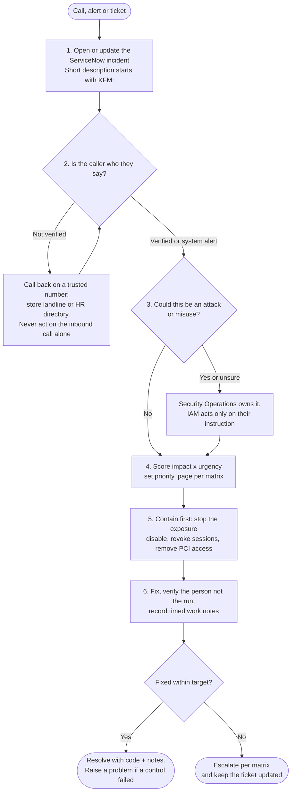

# Runbook: IAM incident triage and escalation

| Field | Value |
|---|---|
| Runbook ID | IAM-RB-001 |
| Version | 1.0 |
| Owner | IAM Governance (operation), IT Director (approval) |
| Last reviewed | 2026-11-16 |
| Related | IAM Access Control Policy (§4, §7.3, §9, §10), IAM-SOP-001 leaver, trend report G2/G3, `docs/servicenow/m5.3-incidents.md` (INC 1–6) |
| Framework controls | PCI DSS 8.2.5, 10.7.2, 12.10.1; NIST SP 800-53 IR-4, IR-6, AC-2; CIS Controls v8 17.1–17.4 |

*Built in a lab environment (Microsoft Entra ID Governance, ServiceNow PDI). Keystone stores run 24/7, so IAM on-call runs 24/7 for P1 and P2.*

## 1. Triage in six steps

Rules that apply at every step:
- **Contain first.** If access may be in the wrong hands, remove it before working out why.
- **Verify the person, not the run.** A workflow saying "completed" is not proof (trend report G1, G4). Check with `show_person_access.ps1` or the portal.
- **Work notes, not memory.** Every action gets a time, what was done and why. Corrections are new notes; notes are never deleted.

## 2. Priority and response targets

Priority = impact × urgency (matrix in `docs/servicenow/m5.3-incidents.md`). **Impact 1** = PCI-scope or admin access exposed, or a security control down. **Urgency 1** = harm happening now, or a hard deadline under 4 hours away. The time of day never lowers urgency.

| Priority | Response (analyst actively working) | Contain / resolve target | Hours | Paged |
|---|---|---|---|---|
| **P1 Critical** | **15 min** | Contain within 1 h, resolve within 4 h | 24/7 | IAM on-call by phone; Security Operations if security |
| **P2 High** | **30 min** | Resolve within 8 h | 24/7 | IAM on-call by phone |
| **P3 Moderate** | **4 h** | Resolve within 3 business days | Business hours | IAM Operations queue |
| **P4 Low** | **1 business day** | Resolve within 10 business days | Business hours | IAM Operations queue |

**Raising or lowering priority:** allowed when the matrix misses a business factor (e.g. a PCI review deadline, INC 4). Write the reason in a work note. Never lower a priority to meet a target.

## 3. Escalation matrix

| Situation | Escalate to | When | How |
|---|---|---|---|
| Possible attack: impossible travel, unknown sign-in, credential leak | **Security Operations** (owns the incident) | Immediately, before changing anything that destroys evidence | Phone, then reassign the ticket |
| Break-glass account signed in | **Security Operations + IT Director** | Immediately | Phone both |
| P1 not contained within 1 h, or P2 not resolved within 8 h | **IT Director** | At the deadline | Phone (night) / ticket (day) |
| PCI-scope access exposed (Cash Office, POS) for a leaver or compromised account | **CISO** (via IT Director) | Same day | Email with ticket number and exposure window |
| A control failed (workflow task failed, review didn't apply, alert missing) | **IAM Engineering** as a problem | When found | ServiceNow problem linked to the incident |
| Wrong or missing HR data (manager, hire, termination, department) | **HR Service Center** | When found; same day for hires and terminations | Ticket to HR; never fix it in Entra |
| Business decision needed (exception, staffing, who should have access) | **Role owner** (e.g. Director of Store Operations) | When found | Ticket or email; IAM recommends, owner decides |

## 4. Playbooks

| Type | First three actions | Never | Worked example |
|---|---|---|---|
| **Locked out / forgot password** | 1. Call back the store landline and confirm employee ID. 2. Check sign-in logs: forgotten password or attack? 3. Issue a one-time Temporary Access Pass (1 h) on the verified line | Share or "borrow" another person's login (policy §9) | INC 1, P2, 13 min |
| **Compromised account** | 1. Hand to Security Operations. 2. On their instruction revoke sessions and disable. 3. Reset via TAP on a verified line, re-register MFA | Contact the user by email (the mailbox may be compromised) | INC 2, P1 |
| **Leaver still has access** | 1. Disable and revoke sessions now (SOP-001 Path B). 2. Remove PCI and admin packages; verify with `show_person_access`. 3. Check sign-ins since the leave time; SecOps if any | Wait for the workflow's next run; re-enable for any reason | INC 3, P1 |
| **Reviewer can't see a review** | 1. Check the review's stage and dates. 2. Check the reviewer is the right person (manager record). 3. Route wrong data to HR | Change the manager in Entra; approve on the reviewer's behalf | INC 4, P3 (real R2) |
| **Bulk joiners at short notice** | 1. HR on-call enters the hires today. 2. Confirm the nightly load (PreHire count). 3. Issue one-time passes to the store manager on day one after J2 | Create accounts by hand (no HR record = no leaver, no review) | INC 5, P2 |
| **Break-glass sign-in** | 1. Call the IT Director and the break-glass holder list. 2. Treat as unauthorised: SecOps owns it. 3. Rotate credentials and revoke sessions using the second account; review the audit log | Disable the account (it is the emergency path) | INC 6, P1 |

## 5. Alerts: designed, not yet built

Two gaps from the trend report need alerts. Both are **designed only**: the lab trial ends 2026-11-19 and the lab has no Azure subscription for log storage.

| Alert | Why | Trigger | Goes to | Priority |
|---|---|---|---|---|
| **A1. Failed lifecycle workflow task** (trend report G3) | Finley's mover task failed unnoticed for 9 days; a failed leaver task would sit silently | Any workflow run with failed tasks > 0 (count failed tasks, not run status: a failed task shows as "completedWithErrors") | ServiceNow incident to IAM Operations | P1 for JML-L1/L2 (leaver), P2 for J/M workflows |
| **A2. Break-glass sign-in** (policy §7.3) | Every use of a Global Administrator emergency account is an incident | Any successful or failed sign-in by bg-emergency01 or bg-emergency02 | Phone/SMS to IAM on-call + Security Operations; ServiceNow P1 | P1 |

**How each would be built:**
- **A1:** a scheduled script, hourly, using the same Graph call as `export_snapshot.ps1` (`userProcessingResults` per workflow, which only keeps 7 days, so hourly is safe). It raises a ServiceNow incident through the ServiceNow REST API for every run with failed tasks, with the workflow, employee ID and failed task name, never object IDs.
- **A2:** send Entra sign-in logs to a Log Analytics workspace (diagnostic settings) and add an alert rule on sign-ins where the user is one of the two break-glass accounts, with an action group that phones on-call and opens the ticket. This is the monitoring Microsoft recommends for emergency access accounts.
- **Until they exist:** IAM checks workflow history every business day (SOP-001 Path A step 3), and the break-glass sign-in log weekly. These manual checks are the control today.

## 6. After the incident
- Resolution notes say what was done, the exposure window (from when to when access was wrong), and what is still open.
- If a control failed, raise a problem to IAM Engineering and add the gap to the policy's gap register (policy §13).
- P1 incidents get a short review within 5 business days: timeline, what worked, what to change. Monthly, P1/P2 counts and missed targets go into the governance trend report.

## 7. Gap register additions

| # | Gap | Owner | Due |
|---|---|---|---|
| R1 | Alert A1 (failed workflow task) not built | IAM Engineering | 2026-11-25 (same as trend report G3) |
| R2 | Alert A2 (break-glass sign-in) not built; needs a Log Analytics workspace | IAM Engineering + Security Operations | 2026-12-14 |
| R3 | No paging tool: on-call reached by phone list | IT Director | 2026-12-14 |
