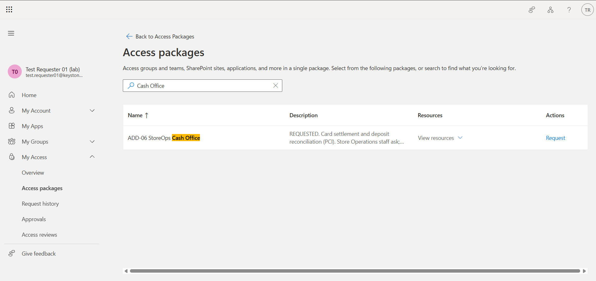
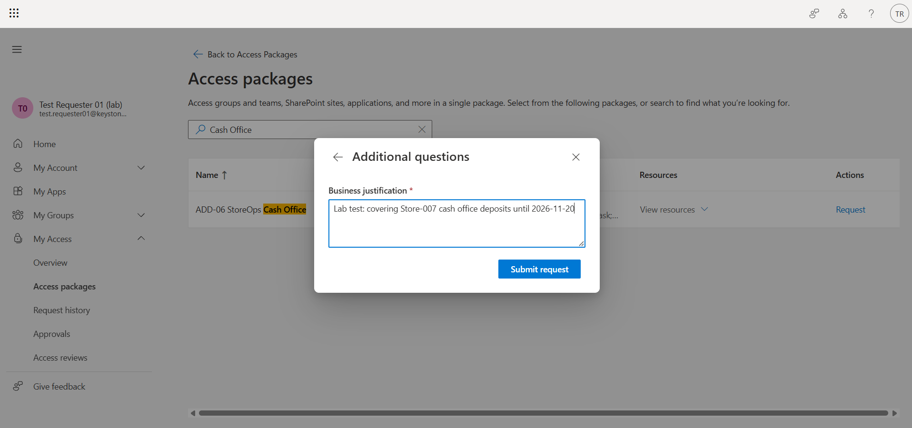
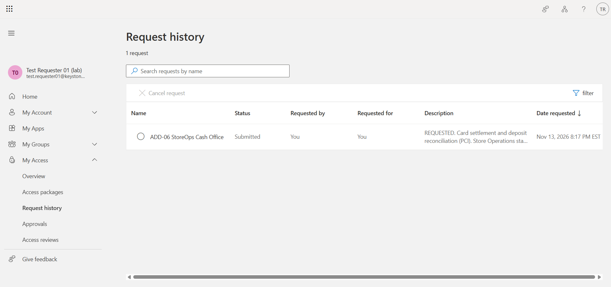
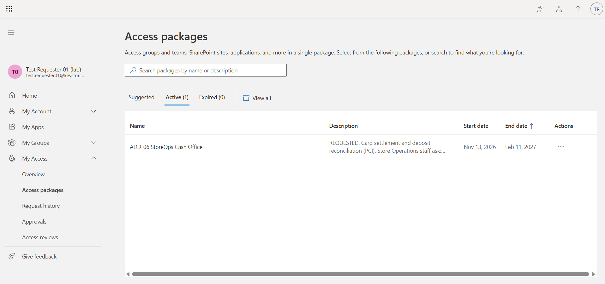

# How to request access: Cash Office (StoreOps Portal)

*For Keystone store staff · 1 page · Version 1.0, 2026-11-13 · Screens captured in a lab environment with a test account*

Most of your access comes with your job automatically: the timeclock, the learning portal and the POS role for your title. You only need this guide for **extra access you must ask for**, like **Cash Office** (counting deposits and settling card batches).

## Before you start
- Use **your own** Keystone sign-in. Never use someone else's login, and never give yours out, even to cover a shift (policy §9).
- Have your reason ready: **what** you'll do, **which store**, and **until when**. For example: *"Covering Store-033 cash office deposits while the Store Manager is on leave, until 2026-11-20."*
- If you can issue POS refunds (Shift Leads), you **can't** also hold Cash Office. The request will be blocked. Ask your Store Manager to arrange cover.

## Steps

**1. Open My Access.** Go to **https://myaccess.microsoft.com** and sign in with your Keystone account.

**2. Find Cash Office.** Select **Access packages**, then search for **Cash Office**. Select **ADD-06 StoreOps Cash Office [PCI]**.

**3. Give your reason and submit.** Type your reason in the **business justification** box, then select **Submit request**.

**4. Wait for two approvals.** Your request goes first to **your manager**, then to the **PCI owner**. You can see where it is under **Request history**. If HR has no manager on file for you, it goes to the IAM team instead, and they will ask HR to fix your record.

**5. Start using it.** When both approve, Cash Office appears under your **Active** access packages within a few minutes. Sign out of the StoreOps Portal and back in to see the Cash Office menu.

## What happens next
- **It ends on its own after 90 days.** If you still need it, request it again with a fresh reason.
- **It ends early if you change jobs.** Move to another department and Cash Office is removed within the hour, even mid-shift.
- **It's reviewed every quarter.** The PCI owner may remove it if the reason no longer applies.
- **Finished early?** Tell your manager; they ask the IAM team to remove it. Don't keep access "just in case".

## If something goes wrong
| You see | Do this |
|---|---|
| Cash Office isn't listed | Only Store Operations staff can ask. Check your department with HR |
| "Request blocked" or "can't be requested" | You hold access that conflicts (POS refunds). Ask your Store Manager |
| Request **denied** | Read the approver's reason under Request history. Talk to your manager before asking again |
| Pending for more than 1 business day | Remind your manager. After hours, call the IAM desk |
| Approved, but no Cash Office menu | Sign out of StoreOps Portal completely and sign in again. Still missing after 1 hour → IAM desk |
