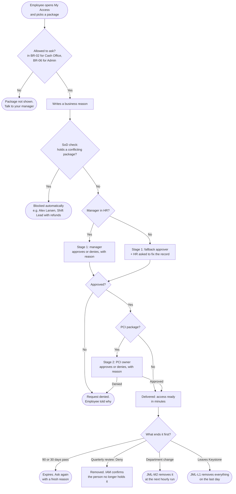

# Access Request Workflow — Keystone Fuel & Market

*Version 1.0 · 2026-11-12 · Owner: IAM Team · Policy: `docs/policy/iam-access-control-policy.md` §3, §5, §8 · Built in a lab environment (Microsoft Entra ID Governance)*

Most Keystone access is never requested: it comes with the job (birthright groups and role packages, policy §3). This workflow is for the **requested** layer: access a person must ask for, with a reason, that ends on its own.

| Package | Who may ask | Approvals | Ends after | Can't be held with |
|---|---|---|---|---|
| ADD-06 StoreOps Cash Office [PCI] | Store Operations staff (BR-02) | 1. Requestor's manager (no manager in HR → fallback approver) 2. PCI owner | 90 days | ADD-01 POS Refunds |
| ADD-07 StoreOps Admin [Privileged] | IT staff (BR-06) | IT Director | 30 days | — |

## 1. The flow

## 2. What actually happened in testing

| Branch | Person | Result | Evidence |
|---|---|---|---|
| Approved and delivered | E00001 Morgan Haddad, Store Manager, Store-007 | Delivered 2026-11-03, expires 2027-02-01 | `evidence/M2.5/request_E00001_ADD-06_*.txt` |
| SoD block | E00013 Alex Larsen, Shift Lead (holds ADD-01 POS Refunds) | Rejected: `InvalidRequestSODCheck`, even as an admin assignment | `evidence/M2.5/request_E00013_ADD-06_*.txt` |
| No manager in HR | E00302 Riley Okafor (joiner) | Manager-dependent steps fail or fall back: her temporary pass failed "Manager attribute is missing or invalid" | `evidence/M1.3/03-j1-riley-failed-task.png` |
| Review Deny | E00070 Avery Castillo (cover ended), E00015 Kai Kowalski (rollout ended) | Review said "Applied" but removed nobody; IAM removed both by hand ~17 h after close | `evidence/M3/07-manual-remediation.png`; trend report G1 |
| Department change | E00034 Finley Moreau, Store Ops → Fuel Ops | Cash Office removed 32 min after the HR change | `evidence/M2.5/pci_mover_workflow_*_1141.txt` |
| Leaver | E00010 Logan Nguyen | All access removed by L1 on the last-day run | `evidence/M1.3/08-leaver-history.png` |

**Lab deviation:** test assignments were made by an administrator (`scripts/request_package.ps1`), which skips the approval stages. The SoD check still ran. A live approval click-through needs a test user who can sign in. On 2026-11-13 a temporary test user requested ADD-06 through My Access and it went through the live fallback (stage 1) and PCI owner (stage 2) approvals: `evidence/M5/03`–`08`.

## 3. Rules that apply at each step

- **Reason:** says what the person will do and until when ("covering the Store-033 deposit until 2026-11-06"), not "need access".
- **Approvers decide on the job.** An approver who doesn't know the person or the need denies and says why. Nobody approves their own request.
- **Temporary need:** the package ends after 90 or 30 days whatever the reason says. If the need ends earlier, the manager asks IAM to remove it, and the next review checks it (Avery's reason said "until 2026-11-06"; the review caught it 3 days later).
- **Exceptions** (access outside these rules, like an Associate holding Cash Office because the store has no manager) follow policy §8: role-owner approval, at most 30 days, recorded in the exception register.
- **Never** share a login instead of requesting access (policy §9).
