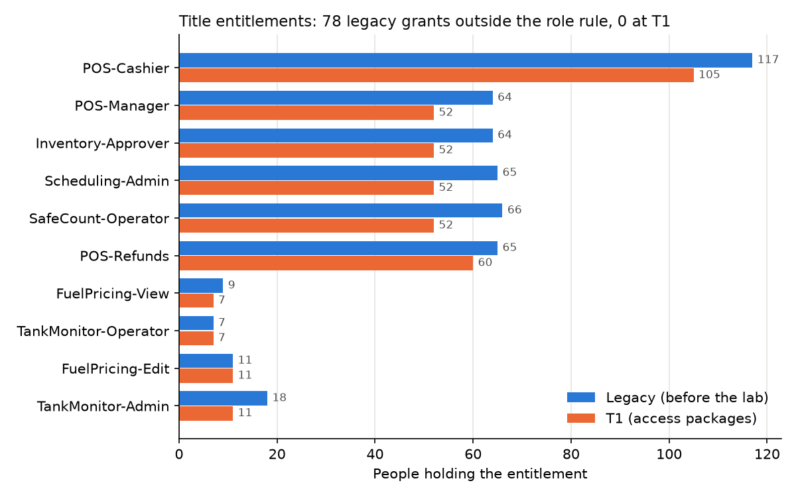
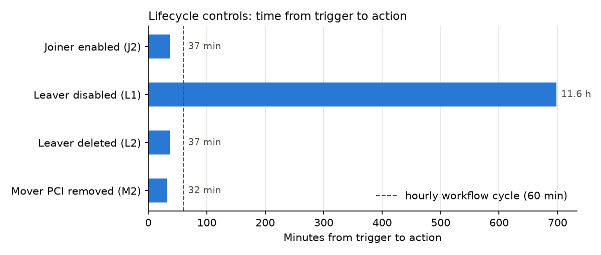

# Governance Trend Report — T0 → T1 (October–November 2026)

*Keystone Fuel & Market · Module M4 · Built in a lab tenant (Microsoft Entra ID Governance trial) · T0 2026-10-27 → T1 2026-11-11 · Report 2026-11-12*

For: Director of Store Operations, IT Director, CISO. Data and method: `notebooks/governance_trends.ipynb` (reads committed evidence only), `reports/m4-kpis.csv`, `reports/m4-anomalies.csv`.

## 1. Executive summary

**What improved**
- **Access now follows the job.** Before the program, 78 of 486 grants of the 10 store and fuel entitlements (16%) went to people whose department and title didn't call for them, and 224 had been granted by request or by hand. At T1, 0 of 409 grants are outside the role rule and every one comes from an access package. A person-by-person drift check finds 0 unexplained grants, and it finds 2 of 2 when problems are planted.
- **Joiner, mover and leaver workflows act within the hour once HR data is in.** Joiners were enabled 37 min after their 03:00 start, Cash Office access was removed 32 min after a department change, and the leaver account was deleted 37 min after its 7-day mark.
- **Every PCI and admin holder was reviewed with a reason.** 8 of 8 decided, 2 denied, both removed.

**What needs action**
- **Two controls reported success without acting.** Access reviews showed "Applied" but removed 0 of 2 denied people (removed by hand ~17 h later). The mover workflow's package removal has removed nothing in 2 of 2 runs.
- **Failures are silent.** 2 of 11 workflow runs had a failed task, and one went unnoticed for 9 days because nothing alerts on a failed run.
- **The controls are only as good as HR data.** A leaver was disabled 11.6 h after his last day because HR entered the termination the next morning. 57 people have no manager in the directory, 9 stores have no Store Manager, and 27 Store Managers report to someone below them, which breaks approvals, temporary passes and review routing.

## 2. KPIs

| Area | KPI | T0 | T1 | Read it as |
|---|---|---|---|---|
| Population | HR accounts / enabled | 278 / 275 | 277 / 277 | 1 leaver deleted, 2 joiners enabled on day one |
| Population | Enabled with no birthright group | 0 | 0 | Every active employee gets baseline access automatically |
| Roles | Title-entitlement grants outside the role rule | 78 of 486 (16.0%)¹ | 0 of 409 | Excess access removed by design |
| Roles | Grants made by request or by hand | 224¹ | 0 | Every grant now traceable to a package |
| Roles | People with an access package / assignments | 0 / 0 | 177 / 241 | Packages built 2026-10-28 |
| Drift | Access not explained by a package | n/a | 0 | Check proven by negative test (2 of 2 found) |
| JML | Workflow runs / with a failed task | 5 / 1 | 11 / 2 | Count by failed task: no run ever showed "failed" |
| JML | Longest a failed run went unnoticed | n/a | 9 days | No alerting (G3) |
| JML | Joiner enabled after hire time | n/a | 37 min | Target: same day ✓ |
| JML | Leaver disabled after leave time | n/a | 11.6 h | Target: same day ✗ (HR entered it late, G2) |
| JML | Mover PCI access removed after HR change | n/a | 32 min | Target: next hourly run ✓ |
| JML | Mover package-removal runs that removed something | n/a | 0 of 2 | G4 |
| Reviews | PCI + admin people decided | n/a | 8 of 8 | 2 denied, each with a reason |
| Reviews | Denials removed by the review itself | n/a | 0 of 2 | G1; both removed by hand |
| Reviews | Agreement with Entra's recommendation (R1) | n/a | 1 of 5 | G7 |
| Data quality | Enabled with no manager | 57 | 57 | G5: unchanged in 2 weeks |

¹ T0 for roles = the legacy access export (`data/t0`, 2026-10-14), because the tenant had no packages at T0.

## 3. Findings

Severity = impact × exposure. **High**: PCI or privileged access can stay with the wrong person, or a control fails without anyone knowing. **Medium**: a control is weakened, but another control limits the exposure. **Low**: hygiene, with no access impact today.

| # | Finding | Evidence | Impact and exposure | Severity |
|---|---|---|---|---|
| **G1** | **Review decisions were not applied.** R1 and R2 showed "Applied", but every apply result was `AppliedWithUnknownFailure` or never left `New`; no removal request reached entitlement management. Likely cause (not confirmed): reviews created through the access reviews API instead of in each package's assignment policy. | `evidence/M3/access_reviews_2026-11-09_1950.txt`, `07-manual-remediation.png`; certification report F1 | Avery kept Cash Office (card settlement) and Kai kept StoreOps Admin ~17 h after the review closed. Only the manual check caught it | **High** |
| **G2** | **Leaver timing depends on when HR enters the termination.** Logan's last day ended 2026-10-26 23:00 ET; HR entered it the next morning; L1 disabled him at 10:38 ET. The workflow itself runs hourly. | T0 snapshot (leave 2026-10-27T03:00Z), T1 run file (L1 14:38Z) | 11.6 h of access after the last day. PCI 8.2.5 expects access revoked immediately on termination | **High** |
| **G3** | **No alert on failed workflow runs.** Riley's TAP failure (no manager) was seen the same day only because we were watching. Finley's mover failure (2026-11-03) was found on 2026-11-12 while building this report. Graph only keeps 7 days of run results, so an unwatched failure ages out. | `evidence/M4.1/snapshot_T1_*_lcw_runs_sanitized.csv`, `01-m1-finley-failed-task.png` | Any failed leaver task (disable, revoke) would sit silently. PCI 10.7.2 requires failures of logical access controls to be detected and alerted | **High** |
| **G4** | **The mover workflow's package removal has never worked.** JML-M1 "Remove all access package assignments" (15-day scheduled removal): Rowan's run had nothing to remove (no packages existed on 10-27); Finley's failed with "Custom assignment schedule is prevented by policy". Likely cause: a 15-day removal is a custom assignment schedule, and the Cash Office package Finley held doesn't allow one (`customSchedule=False`). | `01-m1-finley-failed-task.png`, `evidence/final-2026-11-12/requested_packages_config_*.txt` | Limited today: automatic packages remove themselves when HR changes (BUS-01 gone by 11:42 for Finley) and JML-M2 removes Cash Office and Admin. But `docs/jml-process.md` and `docs/access-packages.md` described a control that didn't exist (corrected with this report) | Medium |
| G5 | **Manager data is incomplete.** 57 enabled people have no manager in the directory; 27 Store Managers report to a Shift Lead or Store Associate (e.g. Jamie Novak E00278 → Cameron Tanaka, now an Associate); 9 of 40 stores have no Store Manager. Unchanged since T0. | `reports/m4-anomalies.csv` A3, A5, A6; `evidence/M1.1/manager_data_quality.csv` | Manager links route Cash Office approvals, new-hire temporary passes (Riley's failed), mover notices and review stage 1 (R2 stage 1 timed out 0 of 3). Fallback to IAM hides it | Medium |
| G6 | **Cash Office held by a non-manager.** Jamie Ivanova (Store Associate, Store-005) holds ADD-06 because Store-005 has no Store Manager. Approved in R1 with that reason. | A2; R1 decision | PCI access outside the usual title, but approved, justified, 90-day expiry and reviewed. Ends when Store-005 has a manager | Medium |
| G7 | **Review recommendations carry no information for store staff.** Entra recommends on sign-in activity; none of the 277 store and office accounts has a sign-in in the lab, so R1 recommended Deny for all 5. The reviewer agreed with 1 of 5, each decision with a job reason. | R1 decisions; A7 | Risk of a reviewer "accepting recommendations" and removing valid Cash Office holders, or of trusting them in auto-apply | Low |
| G8 | **Job title doesn't match department.** Rowan Kowalski (E00004) is in Fuel Operations with the title "Store Associate". | A1 | None today: every package rule checks department and title, so Rowan correctly gets no store package. A title-only rule would have granted it | Low |

**Not findings (lab artifacts):** 277 of 277 accounts show no sign-in, and R3 (inactive 14 days) was 0.7% complete. Synthetic users never sign in, and R3 was left undecided by design. In production the R3 list would be the dormant-account worklist (PCI 8.2.6).

## 4. Escalation table

Due dates count from this report (2026-11-12): High 2026-11-25, Medium 2026-12-14, Low 2027-02-12 (next quarterly report).

| # | Owner (fixes it) | Escalate to if late | Severity | Due | Done when |
|---|---|---|---|---|---|
| G1 | IAM engineering | IT Director | High | 2026-11-25 | Package reviews configured in the assignment policy; a test Deny is removed by the review itself; verify-after-apply step in the review runbook |
| G2 | HR (termination entry) + IAM (runbook) | CISO + HR Director | High | 2026-11-25 | HR agrees terminations are entered by the end of the last shift; involuntary terminations disabled by IAM at once (runbook); leaver KPI measured from HR entry too |
| G3 | IAM operations | IT Director | High | 2026-11-25 | Alert to the IAM queue on any run with a failed task; daily check of run history until the alert is live; run history exported weekly (7-day limit) |
| G4 | IAM engineering | IT Director | Medium | 2026-12-14 | Decide: drop M1's package task (automatic packages and M2 already cover it) or allow a custom schedule on the policies it targets; tested on a mover; docs match |
| G5 | HR (manager records), Director of Store Operations (staffing) | CISO | Medium | 2026-12-14 | No-manager count trending down month over month; every store has a named Store Manager or acting manager in HR |
| G6 | Director of Store Operations | CISO | Medium | 2026-12-14 | Store-005 has a Store Manager, then Jamie's Cash Office removed; or the exception re-approved with an end date |
| G7 | IAM | — | Low | 2027-02-12 | Reviewer guide says recommendations are not a reason; recommendations never used for auto-apply on store populations |
| G8 | HR | — | Low | 2027-02-12 | Rowan's title corrected in HR; a monthly title-vs-department check in this notebook |

## 5. Control mapping

| Framework | Control | Where this report measures it |
|---|---|---|
| PCI DSS v4.0.1 | 7.2.1–7.2.2 access by job classification and least privilege | Role-rule KPI: 78 → 0 grants outside the rule |
| PCI DSS v4.0.1 | 7.2.4 review user access at least every 6 months | Reviews KPIs, G1 |
| PCI DSS v4.0.1 | 8.2.5 access for terminated users revoked immediately | Leaver timing, G2 |
| PCI DSS v4.0.1 | 8.2.6 inactive accounts removed or disabled within 90 days | R3 (lab artifact) |
| PCI DSS v4.0.1 | 10.7.2 failures of critical security control systems (incl. logical access controls) detected, alerted and addressed promptly | G1, G3, G4 |
| NIST SP 800-53 | AC-2 account management (incl. AC-2(3) disable accounts); AU-6 audit record review | JML KPIs, run-history review |
| CIS Controls v8 | 5.3 disable dormant accounts; 6.1 / 6.2 access granting and revoking processes | JML and review KPIs |

## 6. Method and limits

- **Sources:** T0 and T1 snapshots (`export_snapshot.ps1`), workflow run history from the portal (Graph keeps only 7 days), review decisions read back after close, legacy export `data/t0`. All sanitized: no object or tenant IDs.
- **Outcomes, not statuses:** removals are checked in the T1 snapshot (who still holds what), not taken from run or review status.
- **Limits:** one leaver, two joiners and three movers, so timings are single observations, not averages. The HR load time for Finley's move (~16:06 UTC) comes from the test log in `docs/access-packages.md` §10.4, not an export. Legacy (2026-10-14) and T1 (2026-11-11) use different HR dates, so the roles comparison shows the design target, not a removal campaign.
